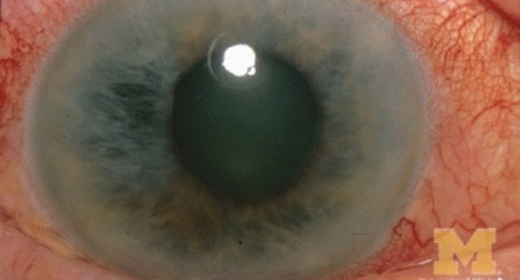

# Majan Eye Centre — Blog Publishing & Content Guide

This guide explains how to create, publish, and manage blog posts on the Majan Eye Centre website using the provided templates.

---

## 1. File Structure Overview

| File | Purpose |
|------|---------|
| `blog.html` | **Main Blog Hub** — Card grid of all articles with live search, category filter buttons, and a "Load More" button (6 articles at a time). |
| `blog-details.html` | **Sample Individual Blog Post** — A fully-realized clinical guide on Cataract Surgery demonstrating all layout elements (TOC, takeaways, tables, doctor quote, doctor author bio, related posts). |
| `blog-template.html` | **Master Copy-Paste Template** — Annotated with 13 clear steps and placeholder brackets `[INSERT ...]` for creating any new blog post. |
| `assets/css/style.css` | **Blog Stylesheet** — Contains all `.blog-*` card, filter, detail, and sidebar responsive CSS rules. |

---

## 2. Quick 4-Step Workflow to Publish a New Blog Post

### Step 1: Duplicate the Template
Make a copy of `blog-template.html` and give it a clean, SEO-friendly file name:
- *Example:* `blog-glaucoma-screening-guide.html`
- *Example:* `blog-lasik-candidacy-oman.html`

### Step 2: Edit the 13 Numbered Steps
Open your new HTML file in an editor (VS Code, Notepad, etc.). Follow the 13 numbered HTML comment banners:
1. **Step 1 (SEO & Meta)**: Change `<title>`, `<meta name="description">`, `canonical`, and OpenGraph tags.
2. **Step 2 (Breadcrumb)**: Update the breadcrumb label to your article’s short title.
3. **Step 3 (Header & Author)**: Update category tag, main `<h1>`, author name, publish date, and reading time.
4. **Step 4 (Featured Image)**: Point to your topic image (e.g. `assets/imgs/service-details/Glaucoma-service.jpg`).
5. **Step 5 (Key Takeaways)**: Update the 3–4 summary bullet points.
6. **Step 6 (Table of Contents)**: Update jump anchor links (`#section-1`, `#section-2`, etc.) to match your headings.
7. **Step 7 (Body Content)**: Write your sections, subheadings, paragraphs, and checkmark lists.
8. **Step 8 (Clinical Tip & Pullquote)**: Add doctor advice and quote attribution.
9. **Step 9 (Comparison Table)**: Optional comparison matrix.
10. **Step 10 (FAQs)**: Common patient questions and answers.
11. **Step 11 (Author Bio)**: Choose Dr. Waleed Bunami or Dr. Anwar Ahmed bio.
12. **Step 12 (Prev/Next Nav)**: Update links to surrounding articles.
13. **Step 13 (Related Articles)**: Point to 2 relevant articles.

### Step 3: Add the Post Card to `blog.html`
Open `blog.html` and add the new card at the **top** of `<div class="row g-4" data-blog-grid ...>` (newest first, 3 cards per row on desktop).

- `data-blog-item` is required — search, filters and "Load More" only see cards that have it.
- `data-category` must be one of: `cataract`, `glaucoma`, `lasik`, `paediatric`, `retina`, `wellness` (these match the filter buttons and the sidebar category links). To add a new category, add a matching `<button class="blog-filter-btn" data-blog-filter="...">` in `blog.html`.
- No pagination to maintain: the first 6 cards show, and a "Load More Articles" button appears automatically once there are more than 6. Change `data-blog-page-size="6"` on the grid to show more per click.

```html
<div class="col-lg-4 col-md-6" data-blog-item data-category="glaucoma">
    <article class="blog-card">
        <div class="blog-card__media">
            <span class="blog-card__category">Glaucoma</span>
            <a href="blog-glaucoma-screening-guide.html" tabindex="-1" aria-hidden="true">
                
            </a>
        </div>
        <div class="blog-card__body">
            <div class="blog-card__meta">
                <span><i class="fa-regular fa-calendar" aria-hidden="true"></i><time datetime="2026-11-05">Nov 05, 2026</time></span>
                <span><i class="fa-regular fa-clock" aria-hidden="true"></i>5 min read</span>
            </div>
            <h3 class="blog-card__title">
                <a href="blog-glaucoma-screening-guide.html">Your Eye Health Article Title Here</a>
            </h3>
            <p class="blog-card__text">
                A brief 2–3 line excerpt summarizing what the patient will learn in this guide...
            </p>
            <div class="blog-card__footer">
                <div class="blog-card__author">
                    
                    <span class="blog-card__author-name">Dr. Waleed Bunami</span>
                </div>
                <a href="blog-glaucoma-screening-guide.html" class="blog-card__read-link">
                    Read More <i class="fa-solid fa-arrow-right"></i>
                </a>
            </div>
        </div>
    </article>
</div>
```

### Step 4: Save and Verify
Open the page in your browser to verify:
- Navigation header links and mobile menu work seamlessly.
- Jump links in Table of Contents jump accurately to sections.
- WhatsApp and Appointment buttons work properly.
- The new card appears on `blog.html`, and is found by the search box and its category filter button.
- Update the "Recent Articles" sidebar and the Previous/Next links on the neighbouring articles.

---

## 3. Recommended Image Dimensions & Available Assets

| Purpose | Recommended Dimensions | Location in Project |
|---------|------------------------|---------------------|
| Card Thumbnail | `800 x 500 px` (16:10 aspect ratio) | `assets/imgs/service-details/` |
| Featured Hero Banner | `1200 x 630 px` (at least 1200px wide so it stays sharp) | `assets/imgs/service-details/` or `assets/imgs/banner/` |
| Doctor Avatars | `120 x 120 px` (1:1 square) | `assets/imgs/team/bunani.jpg` or `anwar.jpg` |
| Sidebar Recent Thumbnails | `150 x 150 px` | `assets/imgs/service-details/` |

### Pre-loaded High-Quality Images in the Project:
- `assets/imgs/service-details/cataract-service.jpg` (Cataract care)
- `assets/imgs/service-details/Glaucoma-service.jpg` (Glaucoma care)
- `assets/imgs/service-details/lasik-service.jpg` (LASIK & Laser vision)
- `assets/imgs/service-details/pediatric-service.webp` (Children’s eye care)
- `assets/imgs/service-details/retina-service.png` (Retina & diabetic care)
- `assets/imgs/service-details/contact-lens.webp` (Keratoconus & specialist lenses)
- `assets/imgs/service-details/Meibomian-service.jpg` (Dry eye & screen fatigue)
- `assets/imgs/service-details/ocuplastic-service.jpg` (Eyelid & oculoplastics)
- `assets/imgs/service-details/Blepharoplasty-service.jpg` (Blepharoplasty)

---

## 4. Author Bios Quick Reference

### Dr. Waleed Bunami
- **Title:** Consultant Ophthalmologist
- **Credentials:** Over 20 years experience, 3,000+ surgeries
- **Speciality:** Cataract Surgery (Phaco), Glaucoma Surgery, Laser Treatments, Diabetic Retinopathy
- **Photo:** `assets/imgs/team/bunani.jpg`

### Dr. Mohammed Anwar Ahmed
- **Title:** Specialist Ophthalmologist
- **Credentials:** Over 35 years ophthalmic experience
- **Speciality:** General Eye Treatment, Paediatric Ophthalmology, Strabismus/Squint, Eye Injuries, Allergies & Dryness
- **Photo:** `assets/imgs/team/anwar.jpg`
